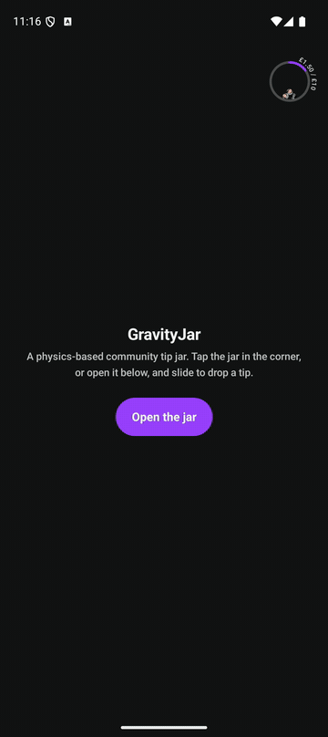
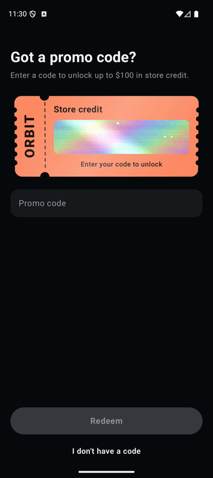

# Compose Showcase

Interactive UI components I built with Jetpack Compose — custom physics, shaders, sensors and
gesture-driven animation. Recorded on an Android emulator.

> Each demo is a standalone Gradle project — open [`gravity-jar/`](gravity-jar) or
> [`scratch-ticket/`](scratch-ticket) in Android Studio and run `app`.

---

## [GravityJar](gravity-jar) — physics-based community tip jar

A live-shopping "Bless the Chat" feature: viewers slide to drop a tip, their avatars fall into a bowl
and settle under gravity, and a progress arc fills toward a shared goal. When the goal is reached
the jar erupts with flame particles.

- **Custom physics** — a JBox2D world drives every avatar; a segmented static ring forms the bowl,
  bodies spawn from the rim, collide, settle and jiggle at full goal.
- **Canvas rendering** — avatars drawn as circular `BitmapShader`s rotated to their physics angle;
  progress arc, orbiting amount badge, flame particles and text-on-a-path all hand-drawn.
- **Frame-driven animation** — a `withFrameNanos` loop steps the simulation and per-avatar
  fade-in / pop / fade-out state machines, pausing itself when every body sleeps.
- **Gesture UI** — a bespoke notch slider with a snapping thumb and speech-bubble tooltip.
- **Low-latency audio** — `SoundPool` feedback with pitch ramping per notch.
- **MVVM** — `ViewModel` + `StateFlow`, unidirectional data flow, repository abstraction.

 

---

## [ScratchTicket](scratch-ticket) — holographic scratch-off reward

A promo-code reward ticket. The scratch panel is covered in holographic foil that shimmers as the
phone tilts; once a code is redeemed the user scratches it off to reveal their credit.

- **AGSL shader** — the foil is a `RuntimeShader`: iridescent band, brushed-silver base, moving
  specular sheen, film grain and glints that twinkle with the viewing angle (gradient fallback
  below API 33).
- **Device tilt** — lifecycle-aware `TYPE_GRAVITY` sensor stream, low-pass filtered, feeding both
  the shader uniforms and a subtle 3D `graphicsLayer` rotation of the whole ticket.
- **Scratch-off** — finger strokes are cut out of an offscreen-composited layer with
  `BlendMode.Clear`; coverage is sampled on a grid and the panel auto-dissolves past a threshold.
- **Custom `Shape`** — ticket outline built with path boolean ops: scalloped edges and perforation
  notches.
- **Polish** — haptic ticks while scratching, a ghost-finger "scratch me" attract loop, spring-animated
  "Added" badge and amount reveal.
- **MVVM** — `ViewModel` + `StateFlow` modelling locked → loading → unlocked → revealed.

 

---

**Stack:** Kotlin · Jetpack Compose · Material 3 · AGSL · JBox2D · Coroutines / Flow

**Author:** Krzysztof Serocki — Senior Android Engineer
