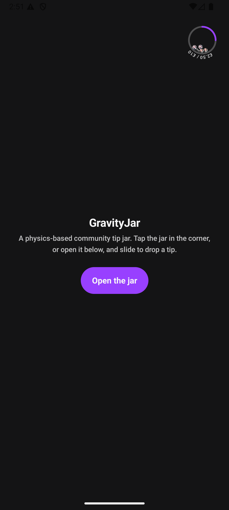

# GravityJar

A physics-based **community tip jar** for Jetpack Compose. Shoppers slide to drop a tip, avatars
fall into a bowl and settle under gravity, and a progress arc fills toward a shared goal — when the
goal is reached the jar erupts with flame particles.

This is a self-contained showcase extracted from a production live-shopping feature ("Bless the
Chat"). All proprietary parts — backend, payments, analytics, design system — have been replaced
with lightweight local stand-ins so the project builds and runs on its own.

| Idle (mini jar) | Full jar + slider |
| --- | --- |
|  |  |

## What it demonstrates

- **Custom physics** — a JBox2D world drives every avatar; a 36-segment static ring forms the bowl,
  bodies spawn from the rim, fall, collide, settle, and jiggle at full goal.
- **Custom Canvas rendering** — avatars are drawn as circular `BitmapShader`s rotated to their
  physics angle; the progress arc, orbiting amount badge, flame particles and the mini jar's
  text-on-a-path are all hand-drawn on `Canvas`.
- **Frame-driven animation** — a `withFrameNanos` loop steps the simulation, staggers avatar drops,
  and runs fade-in / pop / fade-out state machines per avatar, pausing itself when everything sleeps.
- **Gesture UI** — a bespoke notch slider (`detectDragGestures` + `detectTapGestures`) with a
  snapping pill, speech-bubble tooltip, and a shimmering wave animation once the goal is met.
- **Low-latency audio** — `SoundPool` bubble/click feedback with pitch that ramps per notch.
- **MVVM + unidirectional state** — a `ViewModel` exposes `StateFlow`s; the UI reacts and emits
  intents back; a repository abstraction hides the data source.

## Architecture

```
blesschat/
  BlessChatPhysicsEngine   JBox2D world: bowl boundary, avatar bodies, step/jiggle
  BlessChatJarCanvas       Full jar — physics + circular avatar shaders + fade/pop animations
  BlessChatMiniJar         Compact widget: physics avatars + progress ring + orbiting label
  BlessChatProgressArc     Progress arc, amount badge, flame-particle system
  BlessChatSlider          Notch slide-to-tip control with wave + tooltip
  BlessChatAudio           SoundPool feedback
  BlessChatModal           Composes the jar, arc, slider, stats and footer states
  BlessChatViewModel       StateFlows for the jar, config and expanded avatars; tip confirmation
  BlessChatConfig          All tunable physics/layout/animation constants

data/                      Local models + FakeTipJarRepository (simulates live donations)
ui/designsystem/           Small dark design system (colors, type, dimens, buttons, dialog)
demo/                      DemoScreen hosting the mini jar → modal bottom sheet
```

The `FakeTipJarRepository` seeds a partially-filled jar and then simulates other shoppers tipping in
real time, so the jar keeps filling on its own. Confirming a tip fakes a payment round-trip and
occasionally fails, to exercise the in-UI error handling.

## Tech stack

Kotlin · Jetpack Compose (Material 3) · JBox2D · Coil · Kotlin Coroutines / Flow · Timber

## Run it

```bash
./gradlew :app:installDebug   # with a device/emulator connected
```

Or open the project in Android Studio and run the `app` configuration. Tap the jar in the corner —
or the **Open the jar** button — and slide to drop a tip.
